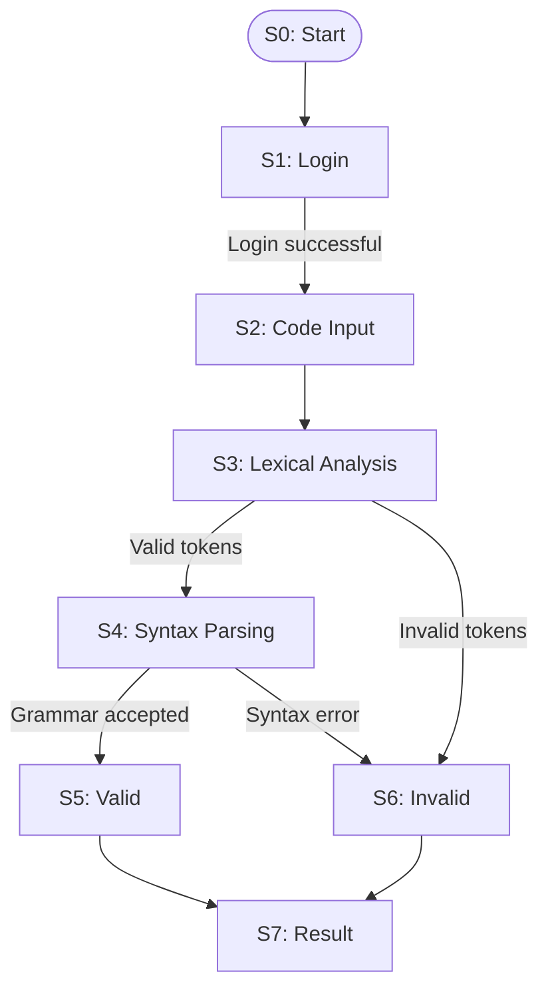

# Automata Design – CodeCheck

## 1. Introduction

CodeCheck is an Online Code Submission and Syntax Validation System. It accepts C source code from students and checks whether the submitted program follows the supported syntax rules using lexical analysis and recursive descent parsing.

## 2. Finite State Machine (FSM)

The CodeCheck workflow is represented using a Finite State Machine.

### States

| State | Name | Description |
|---|---|---|
| S0 | Start | Student opens the CodeCheck application |
| S1 | Login | Student enters login credentials |
| S2 | Code Input | Student enters or submits C source code |
| S3 | Lexical Analysis | Source code is converted into tokens |
| S4 | Syntax Parsing | Tokens are checked using grammar rules |
| S5 | Valid | The submitted code passes syntax validation |
| S6 | Invalid | A syntax error is detected |
| S7 | Result | Validation result is displayed and stored |

### Initial State

S0 – Start

### Final State

S7 – Result

## 3. State Transitions

1. S0 → S1: Student opens the application and proceeds to login.
2. S1 → S2: Successful login allows the student to enter code.
3. S2 → S3: Submitted source code is sent for lexical analysis.
4. S3 → S4: Valid tokens are passed to the parser.
5. S3 → S6: Invalid or unsupported tokens cause an error.
6. S4 → S5: Code that follows the supported grammar is accepted.
7. S4 → S6: Code that violates the grammar is rejected.
8. S5 → S7: Successful validation result is displayed and saved.
9. S6 → S7: Syntax error report is displayed and saved.

## 4. State Transition Diagram

## 5. Conclusion

The Finite State Machine represents the major stages of the CodeCheck application, from student login and code submission to syntax validation and result display.
